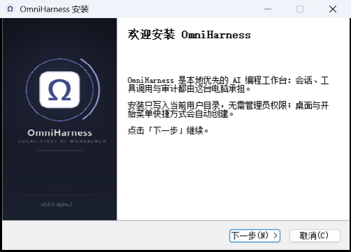
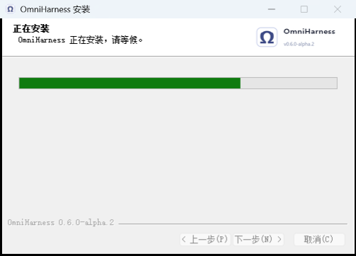

# 安装向导品牌素材（NSIS）

`electron-builder.yml` 的 `nsis` 段引用本目录的三个 BMP 与一个 `.nsh`。
它们只在打包时使用，**不进 app.asar**（`files` 只收 `dist/**` + `package.json`）。

| 文件 | 尺寸 | 用途 |
| ---- | ---- | ---- |
| `installerSidebar.bmp` | 164 × 314 | 安装向导欢迎页/完成页左侧品牌图（`MUI_WELCOMEFINISHPAGE_BITMAP`） |
| `uninstallerSidebar.bmp` | 164 × 314 | 卸载向导欢迎页左侧品牌图（`MUI_UNWELCOMEFINISHPAGE_BITMAP`） |
| `installerHeader.bmp` | 150 × 57 | 内页右上角页眉图（`MUI_HEADERIMAGE_BITMAP`） |
| `installer.nsh` | — | 页面钩子：欢迎/完成/卸载页文案，全新安装时去掉「为谁安装」页（`nsis.include`） |

## 为什么是 BMP 而不是 PNG

NSIS 的 MUI 只接受 **24 位 BMP**（32 位带 alpha 会被 makensis 拒绝），尺寸也必须精确：
侧栏 164×314、页眉 150×57。换图时别让图像工具顺手改成 PNG 或 32 位，否则打包会在
makensis 那一步失败。

## 配色与图形口径

与 `../static/icon.svg` 同一套品牌件（白瓷砖 + 靛墨 Ω + 淡靛描边）：

| 用途 | 色值 |
| ---- | ---- |
| 瓷砖底 / 描边 / 字形 | `#ffffff` / `#c9d0ea` / `#3d4a86` |
| 侧栏渐变（上→下） | `#0e1016` → `#1b202f` |
| 侧栏辉光 / 弧线 | `#6f7bd8`（约 18% 透明度） |
| 页眉底色 / 文字 | `#ffffff` / `#1b2033`、版本行 `#7c87a8` |

图形元素：细底环 + 一段亮弧（呼应应用内 `BrandMark` 的「月弧」加载态）+ 居中的品牌瓷砖，
下方为 `OmniHarness` 字标、`LOCAL-FIRST AI WORKBENCH` 微字距说明、底部版本号。
小尺寸下的可读性优先于装饰，所以侧栏不放正文文案——正文全部由向导页面自己渲染（可随语言切换）。

实机预览（本机 150% 缩放，2026-11-14 构建的安装包）：

## 图标（`../static/`）

- `icon.svg`：设计源；`icon.png`：512×512（窗口/托盘/文档用）。
- `icon.ico`：16/20/24/32/40/48/64/128/256 共 9 帧，**每档按目标像素单独渲染**并封装成
  32bpp DIB 帧（不用 PNG 压缩帧——makensis 与部分老工具对此支持不一致）。
  小尺寸帧把 Ω 提到瓷砖内高约 56–60%、描边保持 1px，避免在任务栏 16–24px 上糊成一团白块。
- `icon-busy.png`：托盘「回合进行中」变体（右下角绿色状态点）。

任务栏取帧路径：`desktop/src/main/app/AppIcon.ts` 在 Windows 上把 `icon.ico` 交给
`BrowserWindow`，由系统按当前 DPI 选 16/20/24/32/48 帧；其它平台用 512 PNG。

## 重新生成

生成物直接入库（与 `static/icon.*` 同一约定），仓库不引入图像库依赖。重做时按上表的
尺寸/位深/色值出图，或改设计源后重新导出，覆盖同名文件即可；`desktop/scripts/test.mts`
的「安装向导品牌素材」判据会校验 BMP 尺寸与位深，尺寸写错会在 `npm test` 就被拦下。
