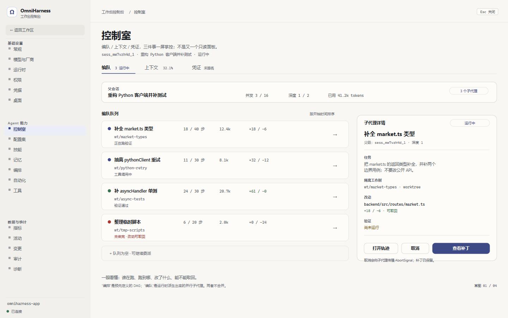
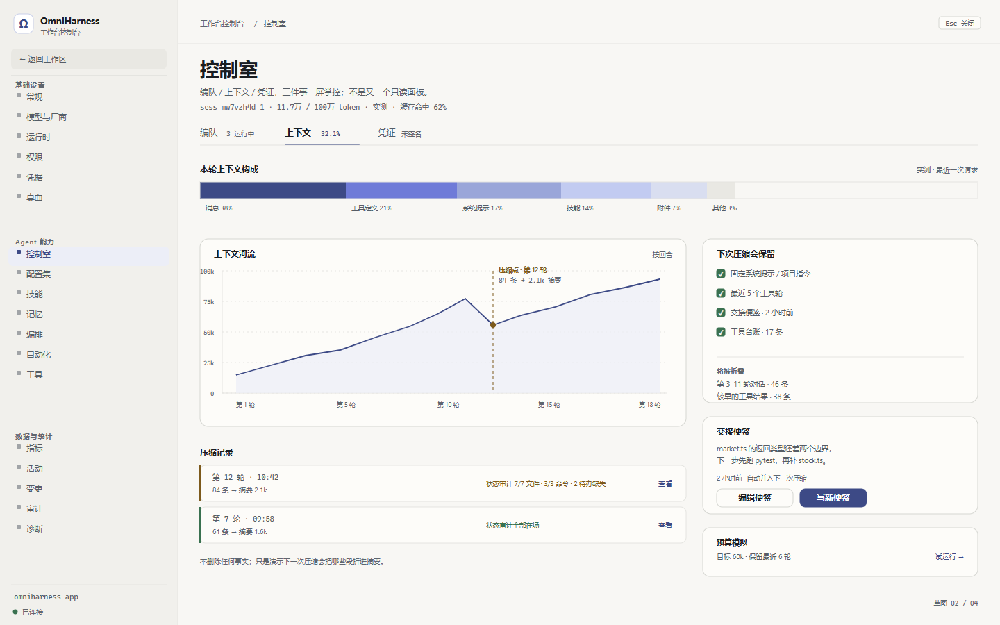
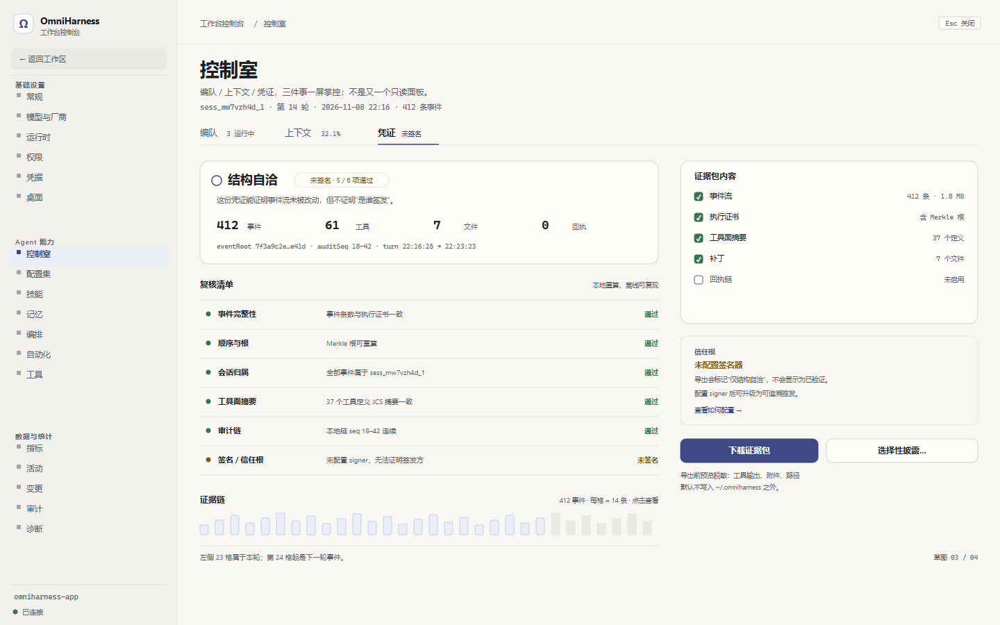

# 控制室（Control Room）· 功能需求与设计

> 状态：**v1 + P2 + P3 已实现**（2026-11-11）；P3 含取消/应用补丁/便签/压缩/本机签名
> 日期：2026-11-10（设计）/ 2026-11-11（v1 实现）  
> 内核：`@omniharness/kernel@0.1.0-alpha.16`  
> 范围：Web 控制台 + 桌面壳共用；沿用「纸与墨」视觉体系，不新建视觉世界  
> 配套草图：`01-control-room-fleet.png` / `02-control-room-context.png` / `03-control-room-proof.png` / `04-control-room-ia.png`  
> 草图口径：按 **v2 目标态**绘制（含取消 / 写便签 / 应用补丁等动作）；v1 只显示其中的只读部分，破坏性按钮隐藏。

---

## 0. 一页结论

调研起点是 19 个功能面板、92 个 RPC；v1 落地后为 **20 个面板 / 104 个 RPC**（新增 `control` 与 12 个读/写方法）。

1. **子代理编排**：内核有 `SubagentOrchestrator` / `SubagentResult` / 隔离工作树 / 补丁回传，应用侧只有 CLI `workflow` 在用，Web 只能通过 `agents.list` 选一个“智能体角色”，看不到运行时编队。
2. **上下文压缩**：内核有确定性的 `CompactionReconstructor`、压缩状态审计、工具台账、交接便签；Web 只有左下角容量图表，看不到“压缩切点、丢了什么、下次还会丢什么”。
3. **执行凭证**：内核已有执行证书、事件 Merkle、审计包、选择性披露包；Web 的「审计」只展示一条全局哈希链，无法回答“这一轮能不能被离线复核”。

因此本轮不建议再加三个互不相干的面板，而是新增**一个**「控制室」入口，内部三个模式：

| 模式 | 回答的问题 | 内核主能力 | 默认动作 |
| --- | --- | --- | --- |
| **编队** | 谁在跑？跑到哪？改了什么？ | `SubagentOrchestrator`、`SubagentResult`、worktree patch | v1 观察 / 看补丁；v2 取消 / 回并 |
| **上下文** | 模型还记得什么？下次会丢什么？ | `ContextCompactor`、`StateAudit`、scratchpad | v1 看压缩史 / 模拟；v2 写便签 |
| **凭证** | 这一轮能不能被离线复核？ | `ExecutionCertificates`、`EventMerkle`、`AuditBundle` | v1 生成 / 校验 / 导出；v3 签名 |

三个模式共用一个会话上下文、一个导航入口、一套状态语义。**v1 默认为只读**；取消、应用补丁、强制压缩、导出签名包等动作放到 v2/v3，逐项确认。

### 0.1 已实现状态（2026-11-11）

| 项 | 状态 | 落点 |
| --- | --- | --- |
| 一个「控制室」入口（3 tab） | 已实现 | `web/src/ui/components/tabs/ControlTab.tsx` + `web/src/ui/components/tabs/control/*` |
| 深链 `#pane=control&view=fleet\|context\|proof` | 已实现 | `web/src/core/Router.ts`、`RouteBinding`、`App.ts` |
| 编队只读（事件流解析 + worktree patch stat） | 已实现 | `src/apps/server/services/fleet/*`、`fleet.list` |
| 上下文只读（六类构成 + 压缩游标 + 便签未接线） | 已实现 | `src/apps/server/services/context/*`、`context.studio` |
| 凭证只读（证书 + 6 项复核 + JSON 导出） | 已实现 | `src/apps/server/services/proof/*`、`proof.turns/build/export` |
| P2 编队补丁预览（限目录/限 512 KB） | 已实现 | `fleet.patch`、`fleetPatchReader.ts` |
| P2 证据包导入复核（结构自洽，不信任签名） | 已实现 | `proof.verify`、`proofVerifier.ts` |
| P3 取消/应用补丁 | 已实现 | `fleet.cancel`、`fleet.applyPatch`、`FleetToolPort`、`FleetPatchApplier` |
| P3 交接便签/强制压缩 | 已实现 | `context.handoff.*`、`context.compact`、`ContextCompactionService` |
| P3 本机签名/信任根 | 已实现 | `ProofSignerService`、Ed25519、`ExecutionCertificates.sign`、`AuditBundles.sign` |
| 取消 / 应用补丁 / 写便签 / 强制压缩 / 签名 | **已实现（P3）** | 见 `06-p3-actions-and-trust.md` |
| 判据 | 180 文件 / 828 用例全绿；桌面冒烟 8 项；axe 桌面控制室 0 serious/critical | `npm run web:test`、`desktop/scripts/smoke.mjs` |

诚实边界保持不变：未配置 signer 时凭证只显示「结构自洽（未签名）」；压缩审计不落事件流时显示「未记录审计」；scratchpad 未接线时显示「便签通道未接线」。

---

## 1. 调研：内核能力与当前功能之间的真实缺口

### 1.1 调研口径

- 内核：`node_modules/@omniharness/kernel`（alpha.16，19 个域）及其 `dist/**/*.d.ts`。
- 宿主：`src/apps/server/modules/` 的 16 个模块、92 个 RPC；`src/apps/server/core/serverServices.ts` 的共享服务。
- 前端：`web/src/ui/models/PanelRegistry.ts` 的 19 个面板、`ConsoleRegistry.ts` 的三组导航。
- 只认“代码里真的接上了”的能力：`.d.ts` 存在但应用零 import 的，一律算缺口，不算已交付。

**证据索引**

| 结论 | 证据 |
| --- | --- |
| 子代理只在 CLI workflow 装配 | [cliAgentCmds.ts](../../../src/apps/cli/cliAgentCmds.ts) 的 `new WorkflowRunner(SubagentPorts.portsOf(runtime), …)` |
| 凭证能力只再导出了 JCS | [util.ts](../../../src/host/kernel/util.ts) 的 `export { Jcs }` |
| 上下文 UI 只消费 `context.usage` | [contextUsageService.ts](../../../src/apps/server/services/contextUsageService.ts)、[CapacityDock.tsx](../../../web/src/ui/components/CapacityDock.tsx) |
| 控制台是 19 个面板的单一入口 | [PanelRegistry.ts](../../../web/src/ui/models/PanelRegistry.ts)、[ConsoleRegistry.ts](../../../web/src/ui/models/ConsoleRegistry.ts) |
| 92 个 RPC / 16 域 | [serverServices.ts](../../../src/apps/server/core/serverServices.ts)、[modules/index.ts](../../../src/apps/server/modules/index.ts) |
| 压缩审计/信号是压缩时的 shadow 输出 | `node_modules/@omniharness/kernel/dist/kernel/context/contextCompactor.d.ts`、`compactionStateAudit.d.ts` |
| 编队结果字段齐全 | `node_modules/@omniharness/kernel/dist/contracts/ports/subagent/subagentResult.d.ts` |
| 执行证书/审计包/披露包已承诺 | `node_modules/@omniharness/kernel/dist/kernel/receipts/*.d.ts` |

### 1.2 基础盘

| 维度 | 当前事实 |
| --- | --- |
| 功能面板 | 19 个（活动 / 技能 / 自动化 / 工具 / 变更 / 文件 / 指标 / 编排 / 记忆 / 配置集 / 治理 / 回滚 / 钻取 / 插件 / 诊断 / 审计 / Trace / 权限 / 凭据） |
| 控制台分组 | 基础设置 / Agent 能力 / 数据与统计 |
| RPC | 92 个方法，16 个域模块声明式注册 |
| 前端导航 | 左栏固定入口 + 控制台左导航；`Ctrl/Cmd K` 命令面板 |
| 已有可观测 | 会话列表、工具调用、变更、指标、容量图表、审计链、Trace、诊断 |
| 已有安全面 | 审批、权限档位、沙箱、凭据保险库、治理台账 |

这盘已经不小。新功能的第一原则不是“再加一页”，而是**把内核已经承诺、前端还没兑现的能力补上，同时不再制造重复入口**。

### 1.3 能力缺口矩阵

| 内核能力 | 当前应用使用情况 | 缺口 | 用户能感到的后果 |
| --- | --- | --- | --- |
| `subagent/SubagentOrchestrator`、`SubagentResult`、`SubagentEventBridge`、`WorktreeOps` | 仅 CLI `workflow` 使用；`src/apps/cli/cliAgentCmds.ts` 里 `new WorkflowRunner(SubagentPorts.portsOf(runtime), …)`；服务端没有 fleet RPC | 没有运行中子代理列表、状态、步骤、token、补丁、取消 | 父代理说“我派了 3 个子代理”，用户只能等最终总结；子代理失败/截断/改动不可取回都不可见 |
| `ExecutionCertificates`、`EventMerkle`、`AuditBundle`、`DisclosurePack`、`ActionReceipt` | 应用侧只经 `host/kernel/util.ts` 再导出 `Jcs`；`audit.query` 是 app 自己的审计链，不是内核执行证书 | 没有按回合生成/校验/导出证据包 | 「审计」只能看事件哈希链，不能回答“这一轮做了什么、事件流有没有被截断、能否离线复核” |
| `ContextCompactor`、`CompactionStateCodec`、`CompactionStateAudit`、`CompactionToolLedger`、`ScratchpadPort` | `context.usage` 只算六类占比与缓存；CLI 有 `--compaction-max`；UI 没有压缩记录 | 看不到压缩切点、摘要、状态审计、交接便签、预算模拟 | 长会话里模型“突然忘了”时，用户只能猜；无法判断是压缩丢了文件/命令/待办，还是模型自身出错 |
| `TemporalFactGraph`、`TemporalFactCard` | `memory.*` 是扁平事实列表 + 搜索；没有时间图 | 没有实体/关系、有效区间、取代关系、冲突消解 | 记忆越积越多，用户不知道哪条仍有效、哪条被新事实取代 |
| `ModelRole`、`RoutePricing`、`BudgetedModel` | 模型选择是单模型 + reasoning；角色路由未接 | 没有 planner / executor / reviewer / compactor 的角色分配与成本预估 | 所有工作都用同一个模型，成本和能力不匹配；预算熔断前没有解释 |
| `CRISPRSkillEditorPort`、`CrisprEditSpec` | `SkillsTab` 只读，`skills.list` 只返回名称/描述/标签 | 没有技能编辑、差异测试、定点改写 | 用户只能看技能，不能把自己项目里的经验沉淀成可复用技能 |
| `WorkbenchHub` | 应用使用自己的 `ServerEventBridge` / SSE，不是内核 hub | 不是用户可见缺口，暂不动 | — |

### 1.4 关键问题排序

**P0：信任不可见。**  
「审计」是全局哈希链，回答的是“服务端记录过哪些事件”；用户真正会问的是“这一轮的执行能不能被证明没被改过”。内核已经把这套证明拆成执行证书 + Merkle + 审计包，前端却只展示了链的列表。

**P0：并行不可见。**  
`graph` 是预先定义的 DAG，`fleet` 是运行时派生出来的并行子代理。当前 UI 只有前者，用户无法判断父代理是否真的并行、哪个子代理卡住、哪个子代理改的文件能取回。

**P1：上下文不可控。**  
容量图表只告诉用户“用了 32%”，没有告诉用户“下一次压缩会折掉哪一段、折掉后还剩下什么”。内核的确定性重建和状态审计是面向“可复核”的，但 UI 没有把它变成可读的叙事。

**P1：面板之间语义重叠。**  
`活动` / `指标` / `Trace` / `钻取` 都在讲事件；`审计` / `治理` 都在讲记录。再加三个入口只会更乱，所以本轮必须用**一个控制室 + 三个不同问题**收口。

**P2：长期能力不可编辑。**  
记忆是扁平列表、技能是只读目录、模型是单模型。它们不是本轮主线，但设计上要给后续留位置，不能把控制室做成“只读观景台”。

### 1.5 设计判断

- **不新建视觉世界。** 这是现有「纸与墨」体系内的新表面：字体、色板、圆角、发丝线、留白节奏全部继承。
- **不新增三个导航项。** 新增 1 个 `控制室`，内部三模式；每个模式只回答一个问题。
- **不复制已有入口。** 编队不复制「编排」；上下文不复制「记忆」和左栏容量图表；凭证不复制「审计」。
- **先只读，再操作。** v1 把事实看清楚；破坏性动作（取消、应用补丁、强制压缩）必须有预览、确认和失败回执。
- **诚实优先于漂亮。** 未签名就写“未签名”；没跑验证就写“未验证”；子代理截断就写“未做完”，绝不把 `ok:true` 当成“已完成”。

### 1.6 实现依赖：这些数据现在没有持久化

调研中最需要先讲清的一件事：**内核有算法，不等于事件日志里已经有可展示的数据**。以下三项必须在实现前补持久化，否则 UI 只能显示“暂无”或只能显示最近一次内存快照：

| 数据 | 当前状态 | 设计影响 | 建议 |
| --- | --- | --- | --- |
| `CompactionResult.stateAudit` / `signals` | 内核压缩时以 shadow 形式返回；`OMNI_COMPACTION_V1` 标记目前主要保存 `compactedUpTo/headHash/summary` | 历史压缩记录无法可靠展示“文件/命令/待办是否仍在摘要里” | 压缩完成时写 sidecar（如 `session.compactions.json`），或扩展事件 payload 的审计段；不能事后猜 |
| `ScratchpadPort` | 内核 `CompactionOptions.scratchpad` 已支持，但本仓 `serve` 未注入 | 交接便签无法真正“跨压缩存活” | 新增 workspace 级/会话级 scratchpad store，注入 `CompactionOptions`；RPC 只读写该 store |
| `SubagentOrchestrator` 生命周期 | 只在 CLI `workflow` 里装配；`serve` 没有 fleet registry | 编队无法列出运行中子代理 | 在 `AgentRuntimeHost` 创建 subagent 时登记 `FleetRegistry`；v1 可只列进程内运行态 |
| `ActionReceipt` 回执链 | `serve` 未配置 `ReceiptSigner` / 全局回执链 | 凭证只能做“执行证书 + 本地审计链”，不能显示回执签名 | v1 如实显示 `回执 0 / 未启用`；v3 再接 signer/trust store |
| 压缩前后 token | 不能保证每次压缩都留下前后用量快照 | `beforeTokens/afterTokens` 可能是估算 | 有快照才显示实测；没有就显示“前后用量未记录”，不伪造数字 |

这也是本设计的“诚实边界”：**先把没有的数据补上，再谈漂亮的图**。如果不想改持久化，v1 就应把对应区块降级为“尚未记录”，而不是用前端推算冒充事实。

---

## 2. 产品定义

### 2.1 用户与场景

| 用户 | 场景 | 心理状态 | 成功标准 |
| --- | --- | --- | --- |
| 个人开发者 | 一个长任务跑了 20 分钟，模型说“已完成” | 怀疑、想快速核对 | 30 秒内看出改了哪些文件、哪些子代理失败了、能否回滚 |
| 技术负责人 | 要把一次 Agent 运行交给同事复核 | 需要可交付证据 | 导出一个包，同事离线能验；未签名也如实标注 |
| 维护者 | 长会话上下文接近窗口 | 担心遗忘关键约束 | 看到压缩切点与丢失项，写一条交接便签，再继续 |
| 桌面用户 | 多任务并行，窗口切来切去 | 需要一眼看到运行态 | 标题/导航有轻量运行指示；打开控制室即见编队 |

### 2.2 Job 与成功定义

**Job**：在 Agent 运行中或运行后，让用户用一屏回答三个问题——  
“它在怎么跑 / 它还记得什么 / 它能被证明什么”。

**成功**：
- 打开控制室后，不需要读原始 JSONL，也不需要切换 3 个面板。
- 看到任何状态都能知道下一步动作，且动作后果可预期。
- 任何“通过/已验证”的字样都能对应到一条可重算的证据；没有证据就不说通过。

**非目标**：
- 不做通用 BI 仪表盘。
- 不做第二个事件流列表。
- 不做“多智能体聊天室”。
- 不做自动修复/自动回滚；所有写操作由用户确认。
- 不在 v1 引入新的模型调用或新的网络依赖。

### 2.3 一个入口，三个模式

```
工作台控制台
└─ Agent 能力
   ├─ 控制室            ← 新增，唯一入口
   │   ├─ 编队  (fleet)
   │   ├─ 上下文 (context)
   │   └─ 凭证  (proof)
   ├─ 配置集
   ├─ 技能
   ├─ 记忆
   ├─ 编排
   ├─ 自动化
   └─ 工具
```

- 控制台左导航新增 `控制室`，放在「Agent 能力」组的最前面；**不新增第四个分组**。
- 面板 key：`control`；`PanelRegistry` 增加一条：
  - label：`控制室`
  - icon：新增 `gauge`（或复用 `workflow`，但推荐新增一个仪表盘线性图标）
  - description：`编队 / 上下文 / 凭证：一屏掌控当前运行`
  - scope：`session`
- 路由：`#pane=control&view=fleet|context|proof`；如果当前 Router 只有 `pane/thread`，本期增加可选 `view` 字段（默认 `fleet`），不改变旧深链。
- 命令面板：只加一条「打开控制室」，不重复加三个模式；已打开时切到对应模式即可。
- 会话中栏标题栏：只在**有子代理运行**时出现一枚 `3 编队` 状态 chip，点击进入 `control?view=fleet`。没有运行时绝不常驻——避免第二个入口。

### 2.4 信息架构与层级

每个模式固定三段：

1. **会话级头部**：会话标题、模型、连接态、范围；切换会话时整页跟随。
2. **三模式 tab**：编队 / 上下文 / 凭证；每个 tab 带一个“真实状态”badge（运行中子代理数、上下文百分比、最近一轮凭证状态）。
3. **模式内容**：最多 3 个区块，超出滚动；不允许卡片套卡片。

**模式内部禁止重复**：
- 编队里不再放“编排”入口；编排是另一个面板。
- 上下文里不再放“记忆”列表；记忆是长期事实，上下文是当前窗口。
- 凭证里不再放“审计”全链列表；审计是全局链，凭证是单轮交付物。
- 任何模式都不再放“新建任务 / 设置 / 命令面板”——这些已有唯一入口。

### 2.5 设计原则

1. **一屏一问**：每个 tab 只回答一个问题，主标题就是问题域。
2. **先证据，后解释**：凭证先给根/计数/通过项，再给人话解释。
3. **先现状，后动作**：动作按钮永远在事实下方，且文案写清后果。
4. **安静密度**：行高 42–76px，段间距 28–32px；不使用彩色大卡片。
5. **状态不靠颜色**：圆点 + 文案 + `aria-label`；色盲用户也读得懂。
6. **不伪造完成**：`truncated`、`aborted`、`writesUnrecoverable`、`unverified` 一律原样展示。

---

## 3. 共用需求（控制室外壳）

| ID | 优先级 | 需求 | 验收 |
| --- | --- | --- | --- |
| CR-01 | P0 | 只新增 1 个导航条目 `控制室`，位于「Agent 能力」组首位；不新增分组 | 控制台左导航只多 1 项；`PanelRegistry` / `ConsoleRegistry` 判据同步 |
| CR-02 | P0 | 三个 tab：编队 / 上下文 / 凭证；tab 使用 WAI-ARIA tabs，←/→/Home/End 可切换 | 键盘扫描通过；`aria-selected` 唯一 |
| CR-03 | P0 | 深链 `#pane=control&view=fleet|context|proof`；未知 view 落回 `fleet` | 刷新/前进后退可恢复 tab |
| CR-04 | P0 | 切换会话时，三个 tab 都跟随当前 `threadId`；无会话时进入空态，不请求历史默认会话 | 无会话不闪旧数据 |
| CR-05 | P0 | tab 懒加载；切换 tab 中止未完成请求；同会话内再次打开走缓存（≤30s） | 快速切换无迟到响应覆盖 |
| CR-06 | P0 | 只在当前 tab 活跃时刷新：编队允许 2s 轮询/SSE，上下文与凭证不做定时轮询 | 后台不产生持续 RPC |
| CR-07 | P0 | 任何写操作（取消 / 应用补丁 / 写便签 / 强制压缩）必须二次确认；确认文案说明后果 | 无静默写 |
| CR-08 | P1 | 头部状态只用真实事实：运行中子代理数、上下文来源（实测/估算）、凭证是否签名 | 无数据不编造 |
| CR-09 | P1 | 空 / 加载 / 错误 / 部分失败四态齐全；错误给原因与重试 | 失败不显示空白页 |
| CR-10 | P1 | 新文案全部进入 i18n（中/英）；新增 RPC 错误码有可读映射 | `i18nCoverage` 通过 |

### 3.1 页面骨架与尺寸

- 内容区：`max-width: 1120px`，左对齐（控制台左导航 256–284px），左右 48px gutter。
- 页头：标题 28px/1.2，副标题 12px，元信息 10.5px mono；标题下 12px，tab 上 28px。
- Tab：12.5px，active 2px 靛墨下划线；badge 9.5px mono。
- 区块：1px `--border-soft` 的平面容器，12px 圆角，**无投影**；区块内不再套卡片。
- 行：最小 42px；关键子代理/压缩行 52–76px。
- 滚动：内容区单列滚动；表格/长路径不撑破容器；移动端 tab 吸顶。

### 3.2 状态与反馈

| 状态 | 表现 | 文案 |
| --- | --- | --- |
| loading | 骨架行（不是居中 spinner） | `正在读取编队…` |
| empty | 图标 + 一句“这里会发生什么” + 一个下一步 | `还没有子代理` / `尚未压缩` / `还没有可复核的回合` |
| error | 原因 + 重试；保留上一次快照并标“上次成功” | `编队状态不可读：…` |
| partial | 局部失败不卸载整页；失败行标红/琥珀 | `第 2 个子代理的补丁不可取回` |
| stale | 超过 30s 的快照加 `已过期` 标签 | `显示的是 32 秒前的快照` |

### 3.3 响应式

- ≥1180px：两栏（主内容 + 右侧详情/操作），如草图。
- 880–1179px：单栏；右侧详情落到主内容下方，操作按钮吸底。
- <880px：全屏单栏；tab 吸顶；详情用底部抽屉；禁止横向滚动。
- 桌面壳：沿用现有无边框标题条；不在标题条里加控制室按钮。

### 3.4 动效

- 只允许一个 authored moment：  
  - 编队：状态点变化 + 行背景 120ms 过渡；不重排、不闪烁。  
  - 上下文：首次打开时压缩切点线 180ms 自上而下绘制一次。  
  - 凭证：证据链首次出现时从左到右 220ms 填充；之后不再重播。
- 关闭动效：`prefers-reduced-motion` 下全部取消，内容直接出现。
- 禁止：卡片入场、数字滚动、循环呼吸光。

### 3.5 无障碍

- tablist / tab / tabpanel 完整关系；方向键、Home/End、Enter/Space。
- 每个状态点必须有文字或 `aria-label`，不能只有颜色。
- 取消/应用补丁的确认框焦点陷阱与焦点归还，复用现有 `DialogHost` 语义。
- 哈希、路径、token 使用等宽字体，允许选中复制；不要用图片代替文本。
- 对比度：所有正文 ≥4.5:1；图形边界 ≥3:1。

---

## 4. 模式一：编队（Fleet）

> 回答：**谁在跑？跑到哪？改了什么？能不能取回？**



### 4.1 核心叙事

父会话把任务拆给若干子代理；每个子代理在隔离工作树里跑，带自己的步数、token、改动 patch 与验证状态。用户不需要看子代理的完整思维链，只需要看“并行车道 + 一个详情 + 一个可取回的补丁”。

### 4.2 数据模型

```ts
type FleetStatus = 'queued' | 'running' | 'ok' | 'failed' | 'aborted' | 'truncated';

interface FleetNode {
  readonly sessionId: string;        // 子会话 id
  readonly parentSessionId: string;
  readonly task: string;             // 一句话任务
  readonly status: FleetStatus;
  readonly depth: number;
  readonly steps: number;
  readonly maxSteps: number;
  readonly durationMs: number;
  readonly tokens: number;           // usageTokens，未上报为 0
  readonly changedFiles: readonly string[];
  readonly patchPath?: string;       // 工作区相对路径
  readonly patchBytes?: number;
  readonly patchTruncated?: boolean;
  readonly writesUnrecoverable?: boolean;
  readonly writesForbidden?: boolean;
  readonly isolation: 'worktree' | 'copy';
  readonly verificationState?: 'not-run' | 'failed' | 'unverified' | 'passed';
  readonly error?: string;
}

interface FleetSnapshot {
  readonly parentSessionId: string;
  readonly maxConcurrency: number;
  readonly maxDepth: number;
  readonly nodes: readonly FleetNode[];
  readonly collectedAt: string;
}
```

数据来源：
- `SubagentOrchestrator.run/runAll` 的结果 + `childrenOf(parentSessionId)`；
- `SubagentResult` 的 `steps/durationMs/usageTokens/changedFiles/patchPath/verificationState/truncated/aborted/writesUnrecoverable`；
- worktree 的 `isolated` 与 `WorktreeOps.collectChanges`。
- 子代理事件不灌父流；服务端 `FleetRegistry` 只聚合状态，不复制完整轨迹。

状态映射必须显式（不要把 `ok` 直接当完成）：

```ts
function statusOf(r: SubagentResult): FleetStatus {
  if (r.aborted === true) return 'aborted';
  if (r.truncated === true) return 'truncated';
  return r.ok ? 'ok' : 'failed';
}
```

### 4.3 页面结构

1. **父会话条**：父任务摘要、并发 `3/16`、深度 `1/2`、已用 token。
2. **编队队列**：每个子代理一行（不是卡片），状态点 + 任务 + worktree + 步数 + token + 增删 + 状态说明。
3. **子代理详情**（右侧）：任务原文、隔离方式、改动文件、补丁可取回/不可取回、验证状态、动作。
4. **队列空位**：`+ 队列为空 · 可继续委派`；v1 只读时不显示可点击的“委派”，显示“委派需在任务中发起”。

### 4.4 需求

| ID | 优先级 | 需求 | 验收 |
| --- | --- | --- | --- |
| FL-01 | P0 | 列出当前父会话的全部直接子代理，按开始时间排序；深度 >1 时缩进/标 `L2` | 3 个子代理全部可见；不混入其它父会话 |
| FL-02 | P0 | 状态必须区分 `ok` / `truncated` / `aborted` / `failed` / `running` / `queued`；`truncated` 不得显示为成功 | `truncated` 行文案“未做完”且颜色琥珀；不出现绿色 |
| FL-03 | P0 | 每行展示任务、worktree、步数、token、增删、状态说明；长任务两行截断，悬停全文 | 1440px 下不横向溢出；移动端换行 |
| FL-04 | P0 | 详情展示 `isolation`、改动文件、patch 字节、是否截断、是否可取回、验证状态 | 与 `SubagentResult` 字段一一对应 |
| FL-05 | P0 | 运行中状态每 2s 更新（或消费 `fleet.updated` SSE）；tab 不活跃时暂停 | 停止轮询后无请求 |
| FL-06 | P1 | 取消子代理：确认框 → `fleet.cancel` → 取消信号传播；状态变 `aborted`，补丁仍保留 | 取消后 1s 内状态更新；不误删 patch |
| FL-07 | P1 | 查看补丁：侧栏展示 unified diff、文件清单、`git apply` 命令；**不自动应用** | 补丁文本与 `patchPath` 一致；应用需二次确认 |
| FL-08 | P2 | 应用补丁：确认 → 服务端 `git apply` → 结果回执；冲突时给冲突文件与恢复方式 | 冲突不静默；保留原 patch |
| FL-09 | P2 | 委派任务：输入任务、工具白名单、token 预算；达到并发/深度上限时禁用并解释 | 达到上限时按钮禁用，不报错后才说 |
| FL-10 | P1 | 打开子代理轨迹：切到该子会话的 Trace/控制室，不离开当前父会话 | 返回父会话路径清楚 |
| FL-11 | P1 | 显示 `writesUnrecoverable` / `writesForbidden` 的真实原因 | 不允许只显示“失败” |
| FL-12 | P1 | 空态、不可用、子代理已结束、父会话不在跑等状态分别处理 | 无“空白面板” |

### 4.5 交互流程

```
打开控制室 → 编队 tab
  → 选择子代理行
    → 右侧详情（任务 / 工作树 / 改动 / 验证）
      → 查看补丁（只读 diff）
      → 取消（确认，运行中可用）
      → 打开轨迹（切换到该子会话的 Trace）
      → 应用补丁（v2，确认 + 冲突回执）
```

### 4.6 边界与诚实语义

- **不把子代理事件灌进父会话**：子代理轨迹保存在 `SubagentResult.events` / 子会话存储；编队只展示聚合状态。
- **`ok:true` 不等于“完成”**：`truncated` / `aborted` 优先于 `ok` 显示；若两者冲突，以 `truncated/aborted` 为准并给出原因。
- **`copy` 隔离模式禁写**：显示 `writesForbidden` 与“该模式无法取回改动”，不要显示“补丁为空”。
- **补丁截断**：`patchTruncated` 时显示“仅前 N 字节”，文件清单仍完整；不能假装完整。
- **没有运行中子代理**：显示空态，不展示伪造的“0 个成功”。

---

## 5. 模式二：上下文（Context）

> 回答：**模型还记得什么？下一次压缩会丢掉什么？**



### 5.1 核心叙事

上下文不是一条进度条，而是一条有“切点”的河流：每次压缩把前面一段折进摘要，留下最近的消息、固定系统提示、工具台账和交接便签。用户需要看到切点、摘要、丢失状态，并能写一条跨压缩存活的便签。

### 5.2 数据模型

```ts
interface ContextStudioSnapshot {
  readonly threadId: string;
  readonly report: ContextUsageReport;        // 复用 context.usage
  readonly compactions: readonly CompactionMark[];
  readonly handoff: readonly HandoffNote[];
  readonly collectedAt: string;
}

interface CompactionMark {
  readonly at: string;
  readonly turnIndex: number;
  readonly compactedUpTo: number;
  readonly headHash: string;
  readonly summary: string;                   // 可折叠预览
  readonly beforeTokens?: number;             // 仅当有保存快照时给出
  readonly afterTokens?: number;              // 不让前端估算冒充实测
  readonly shrinkSavedBytes?: number;
  readonly stateAudit?: {                     // 需压缩时持久化；旧记录可缺省
    readonly ok: boolean;
    readonly checked: { editedFiles: number; commands: number; openTodos: number };
    readonly missing: readonly string[];
  };
  readonly signals?: { budgetRatio: number; rounds: number; toolResultShare: number };
  readonly degraded?: boolean;                // 兼容旧记录；当前是否降级以压缩结果为准
}

interface HandoffNote {
  readonly id: string;
  readonly text: string;
  readonly tags: readonly string[];
  readonly createdAt: string;
  readonly source: 'user' | 'agent';
}
```

数据来源：
- `ContextUsageService.usage(threadId)`：六类构成、窗口、缓存、实测/估算；
- 会话事件里的 `OMNI_COMPACTION_V1` 标记：用 `CompactionStateCodec.decode` 取 `compactedUpTo/headHash/summary`；
- `CompactionStateAudit` 的 `stateAudit`、`CompactionTriggerSignals` 的 `signals`；
- `ScratchpadPort`：最新便签；v1 只展示，v2 允许追加。
- 如果当前事件流没有压缩记录：显示“尚未压缩”，不伪造一条空记录。

### 5.3 页面结构

1. **本轮构成**：六类堆叠条 + 图例 + `实测/估算` 来源标签 + 缓存命中。
2. **上下文河流**：按回合的 token 曲线；压缩切点为竖线，标注“折叠 N 条 → 摘要 M token”；点击切点展开摘要。
3. **压缩记录**：每条 52px 行：轮次/时间、折叠条数、摘要大小、状态审计（文件/命令/待办）、`查看`。
4. **右侧**：下次压缩会保留什么、将被折叠什么、交接便签、预算模拟。
5. **预算模拟**：目标窗口/保留轮数 → 试运行 → 展示“保留/折叠”计数，不写状态。

### 5.4 需求

| ID | 优先级 | 需求 | 验收 |
| --- | --- | --- | --- |
| CX-01 | P0 | 六类构成与 `context.usage` 同源；来源为实测/估算时必须显示 | 估算不能标成实测 |
| CX-02 | P0 | 每个压缩点显示时间、轮次、折叠范围、摘要（可展开）；有快照才显示压缩前后 token，否则写“用量未记录” | 与事件标记解码结果一致，不伪造数字 |
| CX-03 | P0 | 有持久化审计时逐项展示：已改文件 / 验证命令 / 未完成待办；`missing` 用琥珀/红列出；没有审计时显示“未记录审计”，不显示“全部通过” | 缺失项可读、可定位 |
| CX-04 | P0 | 交接便签展示最新 1–3 条、时间、来源；v1 只读，v2 支持追加 | 追加后立即出现在列表；失败保留原文 |
| CX-05 | P1 | 预算模拟：目标 token / 保留轮数 → 展示保留与折叠计数；不改变真实上下文 | 试运行前后事件流不变 |
| CX-06 | P1 | 不提供“删除事实/忘记”按钮；压缩只折叠，不删除长期记忆 | 无 destructive“forget”入口 |
| CX-07 | P1 | `headHash` 漂移 / 旧记录不可解析 / 无压缩记录分别显示原因 | 不把“坏记录”当“没压缩” |
| CX-08 | P1 | 历史压缩记录可滚动；当前轮次高亮；切换会话后重置缓存 | 切会话不串数据 |
| CX-09 | P1 | 移动端河流高度缩小、图例换行、右侧内容落到主列下方 | 390px 无横向滚动 |
| CX-10 | P2 | 强制压缩（“现在压缩”）仅在确认后调用；展示将折叠的范围；失败不改状态 | 失败保留原 state |

### 5.5 交互流程

```
上下文 tab
  → 看构成（哪些类别占比高）
  → 看河流（切点在哪）
    → 点切点 → 摘要 + 状态审计（文件/命令/待办）
  → 写交接便签（v2）
  → 预算模拟（目标 60k / 保留 6 轮）
  → “试运行”只读结果
```

### 5.6 诚实语义

- **估算必须标估算**：`source=estimated` 时副标题写“估算”，不显示“实测”。
- **没有压缩记录**：写“尚未压缩”，不要显示 0 条假记录。
- **状态审计缺失**：这是“压缩摘要可能丢状态”的信号，不是“运行失败”；用琥珀，不用红色大警报。
- **交接便签不是事实源**：它是跨重置的工作记忆；v1 只展示，不能让用户以为它替代了会话记录。
- **不删除事实**：UI 没有“删除历史”按钮；真正的删除只属于现有会话删除/归档。

---

## 6. 模式三：凭证（Proof）

> 回答：**这一轮能不能被离线复核？**



### 6.1 核心叙事

「审计」告诉你服务端记录过什么；「凭证」把某一轮做成可交付的包：事件流 → Merkle 根 → 执行证书 → （可选）回执链/签名 → 审计包或选择性披露包。用户不需要理解 Merkle 细节，只需要看到“哪些检查通过了、哪些没有、导出的是什么”。

### 6.2 数据模型

```ts
interface ProofTurnSummary {
  readonly sessionId: string;
  readonly turnIndex: number;
  readonly startedAt: string;
  readonly endedAt: string;
  readonly eventCount: number;
  readonly toolCalls: number;
  readonly changedFiles: number;
  readonly certificate?: {
    readonly eventRoot: string;
    readonly toolSurfaceDigest?: string;
    readonly signed: boolean;
    readonly kid?: string;
  };
  readonly state: 'unverified' | 'structural' | 'signed' | 'failed';
}

interface ProofCheck {
  readonly code:
    | 'EVENT_COUNT'
    | 'EVENT_ROOT'
    | 'SESSION'
    | 'TOOL_SURFACE'
    | 'AUDIT_CHAIN'
    | 'SIGNATURE'
    | 'MERKLE_PROOF';
  readonly label: string;
  readonly status: 'pass' | 'warn' | 'fail';
  readonly detail: string;
  readonly kernelCode?: string;  // 如 EVENT_ROOT_MISMATCH
}
```

数据来源：
- 事件流：`runtime.agent().eventsOf(threadId)` / `threads.get` 的分页结果；
- `ExecutionCertificates.build({ events, tools })`；
- `EventMerkle` / `EventMerkle.verifyInclusion`；
- `AuditBundles.build` / `DisclosurePacks.build`；
- 可选签名：`ReceiptSigner` + `TrustStore`；未配置时**不伪造**。

回合边界（必须先定义，否则“第几轮”会漂）：

- 起点：`type === 'user'` 的事件；
- 终点：下一条 `user` 事件之前；如果中途有 `turn_diff`，以本轮最后一个 `turn_diff` 作为“交付点”，但事件范围仍包含到下一轮 user 之前；
- 自动化/系统回合没有 user 起点：单独标 `系统回合`，不与用户回合混排；
- 分页只加载尾部时，正文明确写“当前仅含已加载区间”，证书只对该区间负责，不冒充全量。

### 6.3 页面结构

1. **回合条**：第 N 轮 / 时间 / 事件数；左右切换。
2. **证明摘要**：状态（结构自洽/已签名/失败）、通过项 `5/6`、事件/工具/文件/回执计数、`eventRoot`、`auditSeq`、时间范围。
3. **复核清单**：6 行，状态点 + 说明 + 结果；点击行展开 kernel 问题码与证据。
4. **证据包内容**：事件流、执行证书、工具面、补丁、回执链；未启用项明确“未启用”。
5. **信任根**：未配置 → 琥珀“未签名”；配置后 → kid/算法/验签结果。
6. **操作**：下载证据包（主）、选择性披露（次）、导出前脱敏预览。
7. **证据链**：事件 tick 条；左侧本轮、右侧下一轮；点击定位事件。

### 6.4 需求

| ID | 优先级 | 需求 | 验收 |
| --- | --- | --- | --- |
| PR-01 | P0 | 回合列表按 `user` 事件切分；无 user 的自动化回合单独标“系统回合”或排除并说明 | 不把两个用户回合合并 |
| PR-02 | P0 | 生成执行证书：事件条数、Merkle 根、会话 id、工具面摘要；事件流为空时不出证书 | 与 kernel `ExecutionCertificates` 结果一致 |
| PR-03 | P0 | 六项复核矩阵：事件条数 / 根 / 会话 / 工具面 / 审计链 / 签名；每项给 pass/warn/fail 与 kernel 问题码 | 篡改一条事件后 `EVENT_ROOT_MISMATCH` 可复现 |
| PR-04 | P0 | 未配置 signer 时状态只能是 `结构自洽（未签名）`，不得显示“已验证/可信” | 无签名时 `signatureChecked=false` |
| PR-05 | P0 | 审计链只作为“本地链”绑定展示：seq 范围 + 连续性；不冒充内核回执链 | 文案区分“本地审计链”与“回执链” |
| PR-06 | P1 | 导出证据包：JSON 下载；文件名含 session/轮次/时间；包内含导出时间与格式版本 | 重新读取可解析 |
| PR-07 | P1 | 选择性披露：选事件子集 + 每条 Merkle 包含证明；默认不导出全量事件 | 子集包可离线验包含证明 |
| PR-08 | P1 | 脱敏预览：工具输出、附件、绝对路径可勾选脱敏；默认保留证据完整性并明示“脱敏会改变事件内容”的含义 | 导出前可见变更摘要 |
| PR-09 | P1 | 校验导入包（v2）：本地选择 JSON → 逐层校验 → 结果列表；不自动信任包内签名 | 未给 trust store 时 `UNPROVEN_ORIGIN` |
| PR-10 | P1 | 失败状态可读：空事件 / 会话不匹配 / 根不匹配 / 缺少信任根 / 包过大；不卸载整页 | 每个失败都有恢复建议 |
| PR-11 | P2 | 签名回执（v3）：配置 signer/trust store 后，显示 kid、算法、验签结果；没有 trust store 不显示绿 | 与 kernel `AuditBundles.verify` 一致 |

### 6.5 交互流程

```
凭证 tab
  → 选择回合
    → 自动构造证书（不自动导出）
    → 点“复核” → 6 项逐项检查
      → 任一项 fail → 显示 kernel 问题码 + 建议
  → 勾选导出内容 / 脱敏
  → 下载证据包
  → （v2）导入别人的包 → 校验
```

### 6.6 诚实语义

- **证明的是完整性，不是内容真实性**：事件没被改过 ≠ 模型说的都是真的。文案必须写清。
- **未签名 ≠ 已验证**：只写“结构自洽（未签名）”；不显示绿色盾牌。
- **本地审计链 ≠ 内核回执链**：一个是 app 的 HMAC 事件链，一个是 kernel `ActionReceipt`；UI 分开命名。
- **选择性披露不证明未披露事件不存在**：只证明“我给你的这些事件属于这次运行”；边界写在帮助文案里。
- **导出是本地文件**：默认不上传；如果未来有云端，必须另行授权。

---

## 7. 数据与接口设计

### 7.1 RPC 增量（按阶段）

> 现有 92 个方法；新增方法要同步 `serverModulesParity` 快照与 `ApiClient` 包装。

| 阶段 | RPC | 入参 | 返回 | 说明 |
| --- | --- | --- | --- | --- |
| v1 | `fleet.list` | `{ threadId }` | `FleetSnapshot` | 只读；无子代理返回空数组 |
| v1 | `context.studio` | `{ threadId }` | `ContextStudioSnapshot` | 只读；压缩记录 + 便签 + 报告 |
| v1 | `proof.turns` | `{ threadId }` | `ProofTurnSummary[]` | 只读；按回合分页 |
| v1 | `proof.build` | `{ threadId, turnIndex, includePatches? }` | `ProofBundleView` | 构造证书，不导出文件 |
| v1 | `proof.export` | `{ threadId, turnIndex, mode, redact? }` | `{ filename, content, size }` | 返回 JSON 文本，由前端下载 |
| v2 | `fleet.cancel` | `{ threadId, childSessionId }` | `{ ok, status }` | 传播 AbortSignal |
| v2 | `fleet.patch` | `{ threadId, childSessionId }` | `{ patch, files, truncated }` | 读取可回并补丁 |
| v2 | `fleet.applyPatch` | `{ threadId, childSessionId, confirm }` | `{ ok, applied, conflicts? }` | 二次确认；git apply |
| v2 | `fleet.delegate` | `{ threadId, task, tools?, budget? }` | `{ childSessionId }` | 受并发/深度限制 |
| v2 | `context.pin` | `{ threadId, text, tags? }` | `{ ok, note }` | 追加交接便签 |
| v2 | `context.simulate` | `{ threadId, maxTokens, keepRecent }` | `{ kept, folded, summary }` | 只读模拟 |
| v2 | `proof.verify` | `{ bundle }` | `ProofCheck[]` | 校验导入包 |
| v3 | `proof.disclose` | `{ threadId, turnIndex, indices }` | `{ filename, content, size }` | 选择性披露 |
| v3 | `context.compact` | `{ threadId, force, confirm }` | `{ ok, before, after }` | 危险动作，默认不做 |
| v3 | `proof.sign` | `{ threadId, turnIndex }` | `{ signedBundle }` | 需 signer/trust store |

**v1 加 5 个只读方法**；P2 再补 `fleet.patch` / `proof.verify`，仍不触碰写入路径。

导出大小边界：`proof.export` 返回 JSON 文本只适合中等会话。事件流 >2 MB 时应改走 HTTP 下载端点 / 分片交付（内核已有 `AuditDelivery`），RPC 只返回 `{ filename, bytes, downloadUrl }`；不要让一次 JSON-RPC 回包把 100 MB 事件塞进内存。

### 7.2 事件与刷新

- 编队：
  - 优先：服务端新增 `fleet.updated` SSE 通知（只发父会话、聚合快照，不发子代理原始事件）；
  - 降级：tab 活跃时 2s 轮询 `fleet.list`；`document.hidden` / 切走 tab 时停止。
- 上下文：
  - 打开时 `context.studio` 一次；`sessionTick` 变化后重取（去抖 300ms）；
  - 不轮询。
- 凭证：
  - 打开时 `proof.turns`；选择回合后 `proof.build`；
  - 复核/导出由用户显式触发；不自动生成大包。
- 所有响应都带 `collectedAt`；超过 30s 标 `已过期`。

### 7.3 服务端结构

```
src/apps/server/services/
  fleet/                       ← 新增：FleetRegistry + FleetService
  context/                     ← 新增：ContextStudioService（包在现有 contextUsageService 外）
  proof/                       ← 新增：ProofService（ExecutionCertificates/Merkle/AuditBundles）
src/apps/server/modules/
  control.ts                   ← 新增：fleet.* / context.* / proof.* 注册；或拆 fleet.ts/context.ts/proof.ts
```

- `FleetRegistry` 由 `AgentRuntimeHost` 在派生 subagent 时写入；只在内存保存聚合状态，进程重启后从子会话存档重建（v1 可只显示进程内）。
- `ContextStudioService` 复用 `ContextUsageService`，额外解析事件里的 `OMNI_COMPACTION_V1` 记录；不重新回放整个事件流两次。
- `ProofService` 复用 `runtime.agent().eventsOf` 与 `this.options.tools`；导出走内存 JSON，不写临时文件。
- 三者都通过 `ServerServices` 构造注入，不在模块里 new。

### 7.4 权限与安全

| 操作 | 要求 | 说明 |
| --- | --- | --- |
| 读取编队/上下文/凭证 | 当前会话访问权限 | 不跨工作区；不允许通过 threadId 读别的项目 |
| 取消子代理 | 明确确认 + 当前会话所有者 | 取消信号传播；不可撤销 |
| 应用补丁 | 明确确认 + 冲突预览 | 不自动回滚；保留原 patch |
| 导出证据包 | 明确点击 + 脱敏预览 | 默认本地下载；不上传 |
| 批量导出/披露 | 二次确认 + 大小上限 | 防止一次导出数 GB |
| 查看便签 | 当前会话 | 便签可能含敏感上下文；不跨会话 |

### 7.5 错误码与用户文案

| 错误码 | 触发 | 用户文案 |
| --- | --- | --- |
| `no_session` | 未选会话 | `先选择一个会话，再打开控制室。` |
| `fleet_unavailable` | 服务端未接 FleetRegistry | `编队服务未接线：当前版本只能查看已有子会话。` |
| `subagent_not_found` | 子代理已结束/被清理 | `这个子代理已不在运行列表里；可去 Trace 查历史。` |
| `subagent_running` | 对运行中子代理执行不可逆操作 | `它还在运行，先取消或等它结束。` |
| `patch_unavailable` | 无补丁 / 补丁截断 | `没有可取回的补丁；改动可能仍在隔离工作树。` |
| `context_unavailable` | 事件流不可读 | `上下文报告读取失败：…（保留上次快照）` |
| `compaction_missing` | 没有压缩记录 | `这个会话还没有压缩记录。` |
| `proof_empty` | 回合无事件 | `这个回合没有可复核的事件。` |
| `proof_invalid` | 证书/根/会话不匹配 | `复核失败：事件根不一致（EVENT_ROOT_MISMATCH）。` |
| `trust_root_missing` | 有签名材料但没 trust store | `签名存在，但没有信任根；不能确认签发方。` |
| `export_too_large` | 超过 RPC/下载上限 | `证据包超过 2 MB，请改用下载端点或分片导出。` |

### 7.6 前端集成点

新增一个面板不是只写一个 `*Tab.tsx`；按现有架构至少动这些地方：

| 文件 | 改动 |
| --- | --- |
| `web/src/ui/models/PanelRegistry.ts` | 增加 `control` 条目（label / icon / description） |
| `web/src/ui/models/ConsoleRegistry.ts` | 把 `control` 放进 `AGENT_PANEL_ORDER` 首位 |
| `web/src/ui/models/PanelScope.ts` | `control` scope = `session` |
| `web/src/core/Router.ts` | `VALID_PANES` 增加 `control`；如采用 `view`，扩展 `AppRoute` 解析/序列化 |
| `web/src/ui/App.ts` | lazy import `ControlTab`；`renderPane` case `control` |
| `web/src/ui/components/ControlTab/` | 新目录：`ControlTab.tsx` + `FleetMode.tsx` / `ContextMode.tsx` / `ProofMode.tsx` + `useFleet.ts` / `useContextStudio.ts` / `useProof.ts` |
| `web/src/ui/i18n/en/*.ts` | 所有新文案；`i18nCoverage` 兜底 |
| `web/src/core/ApiClient.ts` | 5 个 v1 方法 + 后续动作方法 |
| `src/apps/server/modules/` | 新增 `control.ts` 或按域拆 `fleet.ts` / `context.ts` / `proof.ts`；登记到 `index.ts` |
| `src/apps/server/core/serverServices.ts` | 装配 `FleetRegistry` / `ContextStudioService` / `ProofService` |
| `tests/serverModulesParity.test.ts` | 更新 92 → 104 等方法数快照 |

面板必须保持「一个 job」：`ControlTab` 只做 tab 容器与会话级请求，不把三个模式的数据请求混在一个 effect 里；每个模式自己的 hook 负责自己的取消与缓存。


---

## 8. 视觉与文案要求

### 8.1 视觉

- **沿用「纸与墨」**：`--bg #f8f7f4` / `--panel #fdfcf9` / `--text #1a1d21` / `--accent #3d4a86`；不新增色族。
- **不用彩色大卡片**：状态用 6px 圆点 + 文案 + 细线；区块最多 1px 边框。
- **留白**：页头 -> tab 28px；tab -> 内容 24px；区块间 28–32px；行内 8–12px。
- **字阶**：28 页标题 / 18 关键数字 / 13 区块标题 / 12 正文 / 10.5 元信息；等宽只给 hash、路径、token、时间。
- **动效**：每个模式只有一个 authored moment；其余 120–180ms 状态过渡。
- **空态**：图标 + 一句“这里会发生什么” + 一个可执行下一步；不写“暂无数据”四个字就结束。

### 8.2 组件清单

| 模式 | 组件 | 单一职责 | 必须覆盖的状态 |
| --- | --- | --- | --- |
| 共用 | `ControlTab` | 会话级 tab 容器、深链、缓存 | loading / empty / error / partial |
| 共用 | `ControlHeader` | 会话、模型、来源、tab badge | connected / reconnecting / no-session |
| 编队 | `FleetLaneList` | 子代理行列表 | queued / running / ok / truncated / aborted / failed |
| 编队 | `FleetDetail` | 选中子代理详情 | missing / running / done / patch unavailable |
| 编队 | `PatchPreview` | 只读 diff + 冲突提示 | empty / truncated / conflict / unavailable |
| 上下文 | `ContextComposition` | 六类构成 + 来源 | measured / estimated / empty |
| 上下文 | `ContextRiver` | 回合曲线 + 压缩切点 | no compaction / 1..N cuts / stale |
| 上下文 | `CompactionRow` | 单条压缩记录 | has audit / no audit / corrupt |
| 上下文 | `HandoffNote` | 便签列表 + 追加 | empty / saved / failed / over limit |
| 上下文 | `BudgetSimulator` | 只读模拟 | idle / running / result / error |
| 凭证 | `ProofTurnStrip` | 回合选择 | no turns / one turn / many |
| 凭证 | `ProofSummary` | 证书摘要与状态 | structural / signed / failed / empty |
| 凭证 | `ProofCheckList` | 6 项复核 | pass / warn / fail / checking |
| 凭证 | `ProofPackage` | 包内容与脱敏 | full / partial / disabled items |
| 凭证 | `ProofHashRibbon` | 事件链定位 | normal / selected / overflow |
| 凭证 | `ProofExportDialog` | 导出选项与确认 | export / disclose / too large / redacted |

### 8.3 文案口径

| 场景 | 必须写 | 禁止写 |
| --- | --- | --- |
| 未签名凭证 | `结构自洽（未签名）` | `已验证` / `可信` |
| 子代理截断 | `未做完 · 步数耗尽` | `成功` |
| 子代理改动取不回 | `改动不可取回` + 原因 | `完成` |
| 上下文是估算 | `估算` + 来源 | `实测` |
| 没有压缩 | `尚未压缩` | `0 条压缩记录`（像坏数据） |
| 验证未跑 | `尚未运行验证` | `未验证通过`（歧义） |
| 选择性披露 | `只证明已披露事件属于本次运行` | `证明全部事件存在` |

---

## 9. 验收标准（端到端）

### 9.1 编队

- 给定 3 个运行中子代理，打开控制室 → 编队，3 行全部可见，每行有状态/步数/token/改动。
- 选中一个子代理 → 详情显示 worktree、changedFiles、verificationState；`truncated` 行显示“未做完”，不显示成功。
- 点击“取消” → 二次确认 → 状态变 `aborted`，补丁仍可读取。
- 查看补丁 → 展示 unified diff；不自动写工作区。
- 子代理失败且 `writesUnrecoverable` → 显示“改动不可取回”，不能显示“无改动”。

### 9.2 上下文

- 给定一个有 2 次压缩且带审计 sidecar 的会话 → 河流显示 2 个切点；每点可展开摘要与状态审计。
- 同一会话只有压缩标记、没有审计 sidecar → 显示“未记录审计”，不显示“0 缺失/全部通过”。
- 状态审计缺 2 个待办 → 琥珀显示具体缺失项，不折叠成“有问题”。
- 写一条交接便签 → 出现在“下次压缩会保留”；刷新后仍在。
- 预算模拟 60k / 6 轮 → 显示 kept/folded 计数；事件流与真实状态不变。
- 无压缩记录 → 显示“尚未压缩”；不显示假切点。

### 9.3 凭证

- 选一轮 → 生成证书；`eventRoot` 可重算；6 项检查逐项显示。
- 篡改一条事件（测试夹具）→ `EVENT_ROOT_MISMATCH`，状态变 fail，不显示通过。
- 未配置 signer → 只显示“结构自洽（未签名）”；`signatureChecked=false`。
- 导出 JSON → 文件可读；包含证书与事件；未启用回执链不伪造空链。
- 选择性披露 → 只含选中事件 + 每条包含证明；不泄露未选事件内容。

### 9.4 全局

- 控制台只多 1 个导航项；命令面板只多 1 条命令；无重复“新建/设置/命令面板”。
- 深链 `#pane=control&view=proof` 刷新后仍在凭证 tab。
- 390×844 无横向滚动；tab 吸顶；详情可用。
- axe：无 serious/critical；tablist/tabpanel 关系正确；键盘可完成主要流程。
- 中/英文案齐全；所有错误有可读原因；不会出现 `undefined` / `NaN`。

### 9.5 轻量成功指标（本地，不上报）

- 打开控制室到看懂“谁在跑/改了什么”的点击次数 ≤2（切 tab + 选行）。
- 凭证页面“复核”到结果 ≤3s（412 事件规模）。
- 上下文页面从打开到看到最近压缩切点 ≤1s（缓存命中）。
- 同一面板内重复入口数 = 0；导航新增条目 = 1。
- 所有“未签名/未验证/未做完”状态都有明确文字，而不是只靠颜色。

---

## 10. 实施顺序建议

| 阶段 | 内容 | 风险 | 依赖 |
| --- | --- | --- | --- |
| **P0 设计确认** | 确认本文件、1 个入口 / 3 模式、v1 只读边界 | 低 | 你确认 |
| **P1 控制室壳 + 上下文只读** | `control` 面板、tabs、深链、`context.studio`、压缩时间线、便签只读 | 中 | 事件标记解析、ContextUsageService 复用 |
| **P1 凭证只读** | `proof.turns/build/export`，证书 + 检查矩阵 + 下载；未签名口径 | 中 | 事件流、ExecutionCertificates、AuditSink |
| **P2 编队只读** | `FleetRegistry`、`fleet.list`、2s 刷新、详情、补丁只读 | 高 | SubagentOrchestrator 接线、worktree patch 暴露 |
| **P2 动作** | 取消、写便签、导入校验、选择性披露 | 高 | 权限/确认/回执 |
| **P3 深度能力** | 委派、应用补丁、强制压缩、签名回执、模型角色路由、记忆时间图 | 很高 | 内核能力与信任根配置 |

推荐先做 **P1 控制室壳 + 上下文 + 凭证**，因为它们只读、能立刻回答“记得什么/能否证明”，并且不需要改主循环；编队需要在服务端接管子代理生命周期，放到第二批。

---

## 11. 开放决策（需要你确认）

1. **一个入口还是三个入口？**  
   本设计选择「控制室」+ 三 tab，避免导航从 19 项涨到 22 项。若你希望三个独立面板，视觉可以复用，但信息架构会回到“多入口”。
2. **凭证是否要求签名？**  
   默认无 signer 时只做“结构自洽（未签名）”。如果目标用户需要对外交付，是否要在 P1 就配置 `ReceiptSigner` 与 trust store？
3. **编队是否允许在 UI 里直接派生子代理？**  
   v1 只读；v2 才允许 `fleet.delegate`。委派会产生真实模型成本，必须明确预算/并发/工具白名单。
4. **上下文是否允许“立即压缩”？**  
   设计上放到 P3，并强制二次确认。默认只做模拟，不主动改真实上下文。
5. **是否把记忆时间图并入「记忆」面板而不是控制室？**  
   建议：控制室只管“当前窗口”，时间图属于「记忆」的下一轮增强，不混入。

---

## 12. 草图索引

| 草图 | 内容 |
| --- | --- |
| [01 编队](./01-control-room-fleet.png) | 父会话条、子代理车道、详情、补丁入口、取消/轨迹动作 |
| [02 上下文](./02-control-room-context.png) | 六类构成、上下文河流、压缩点、状态审计、交接便签、预算模拟 |
| [03 凭证](./03-control-room-proof.png) | 回合摘要、6 项复核、证据包、信任根、证据链、导出 |
| [04 IA 与流程](./04-control-room-ia.png) | 导航落点、三个问题、两条主旅程、数据来源与诚实边界 |

---

## 13. 后续机会（不并入本轮控制室）

这三项也是内核已承诺、前端未兑现的能力，但更适合独立面板/独立批次，不要塞进控制室：

| 机会 | 用户问题 | 内核依据 | 为什么独立 |
| --- | --- | --- | --- |
| **记忆时间图 / Memory Atlas** | “这条偏好现在还有效吗？谁取代了谁？” | `TemporalFactGraph`、`TemporalFactCard`、`validFrom/validTo` | 属于长期记忆，和当前窗口的 Context Studio 不是同一层 |
| **模型路由 / Router** | “规划、执行、审查、压缩该分别用哪个模型？成本差多少？” | `ModelRole`、`RoutePricing`、`BudgetedModel` | 是配置与成本面，不是运行监控面 |
| **技能实验室 / Skill Lab** | “把这次经验沉淀成技能，怎么安全地改？” | `CRISPRSkillEditorPort`、`CrisprEditSpec`、差异测试 | 是编辑面，需要 diff/回滚/测试，不适合只读控制室 |

---

> 设计到此为止，不含实现改动。确认方向后再进入 `shape → 实现 → 验收`；默认建议先做只读的「上下文 + 凭证」，再做「编队」。
